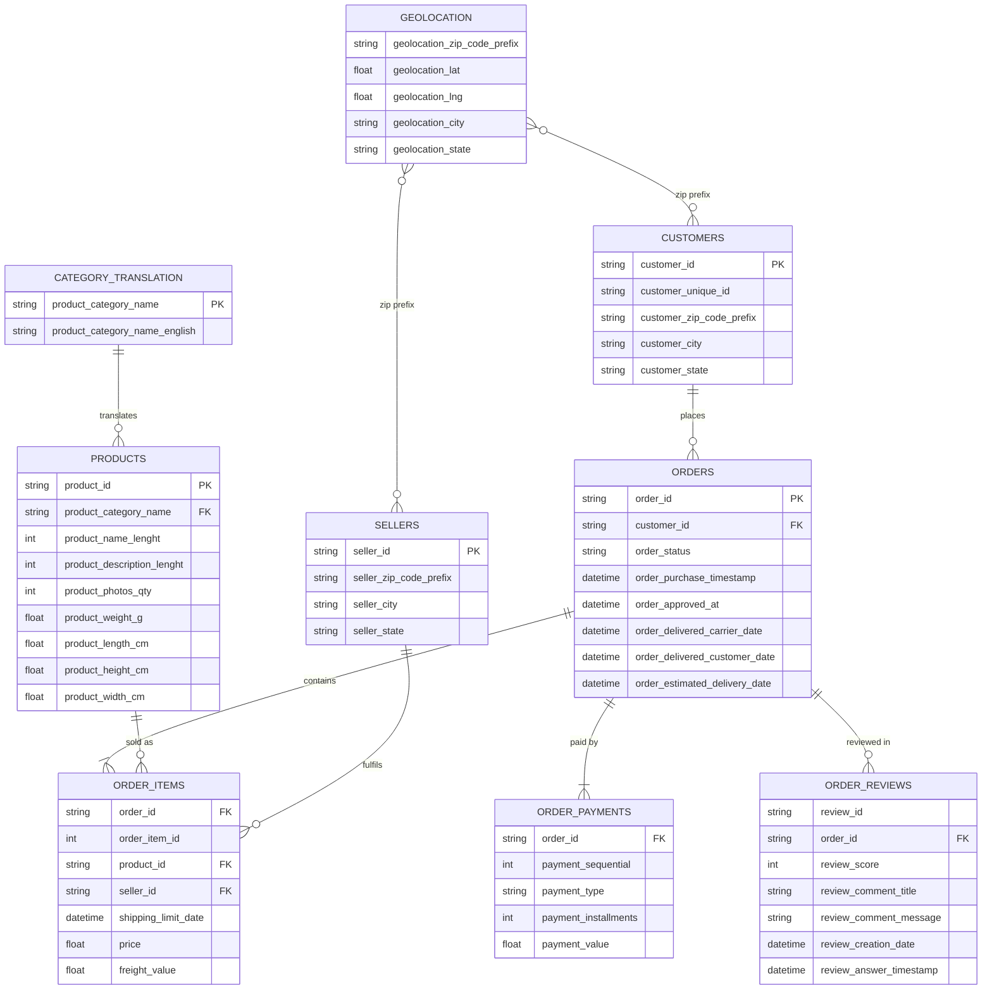

# Entity-relationship diagram — raw Olist tables

`orders` is the hub. Every other transactional table hangs off `order_id`; `customers`, `sellers` and `products` are lookup tables; `geolocation` joins to both customers and sellers on the postcode prefix.

## Grain notes (drive the star-schema design in Phase 2)

| Table | Grain | Consequence |
|---|---|---|
| orders | 1 row per order | Hub for status and timestamps. |
| order_items | 1 row per item in an order | **Chosen fact grain.** Revenue = sum(price); multi-item orders must not be double-counted when joining payments. |
| payments | 1+ rows per order | Aggregate to order level before joining to items. |
| reviews | 0–n rows per order | Deduplicate; keep latest review per order. |
| customers | 1 row per order | `customer_unique_id` is the real customer key → dim_customer. |
| geolocation | many rows per zip prefix | Aggregate to mean lat/lng per prefix → dim_geography. |
